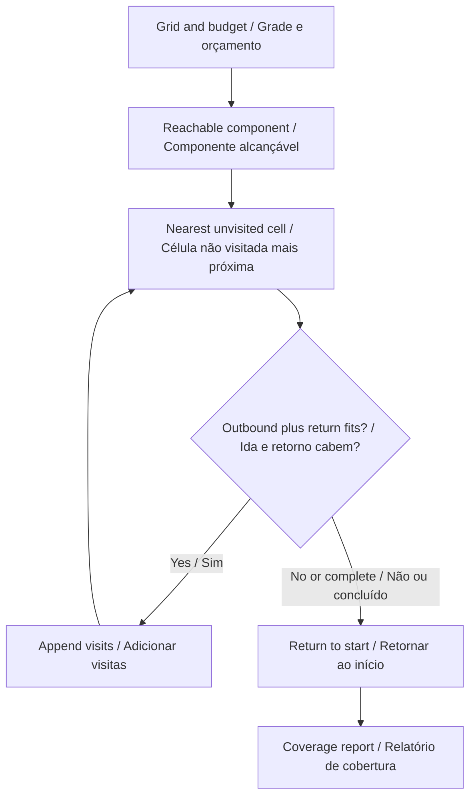
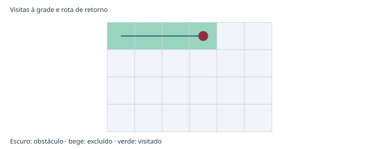

# Go2 PRO Search Coverage

**Rehearse a search route with explicit coverage and a return budget.**  
**Ensaie uma rota de busca com cobertura explícita e orçamento de retorno.**

[](https://github.com/galafis/go2-pro-search-coverage/actions/workflows/ci.yml) · **Working software prototype / Protótipo funcional** · **v0.1.0** · **27 automated tests / testes automatizados** · **MIT**

[English](#english) · [Português](#portugues) · [Live demo · Demonstração](https://galafis.github.io/go2-pro-search-coverage/) · [Five examples · Cinco exemplos](#examples)

## Workflow · Fluxo de trabalho



<a id="english"></a>

## English

A deterministic coverage-route simulator for a supplied training-floor grid. It computes reachable cells, plans visits to new cells and reserves enough movement steps to return to the starting point.

### Why this belongs in the Go2 PRO program

Before a search-and-rescue exercise, instructors need to distinguish a traversed area from a merely drawn route. This workbench exposes disconnected rooms, explicit exclusions and a limited movement budget. It supports course design for a prospective Go2 PRO observation study.

### Implemented behavior

- Compute the connected component of free cells using four-neighbor breadth-first search. Cell values are 0 for free, 1 for obstacle and 2 for excluded.
- At each iteration, find the nearest unvisited reachable cell. Equal-length paths use east, south, west, north neighbor order; this makes the result reproducible.
- Before appending an outbound path, compute the shortest return path from its destination. Accept only when outbound movement plus the return fits the remaining budget.
- When the next greedy candidate cannot be funded, stop searching and append the return path. This policy can leave feasible alternatives unexplored and is not an optimal coverage solver.
- Count visits during both search and return. Report reachable coverage, unreachable free cells, unvisited reachable cells and remaining steps separately.


### Run a complete experiment

Use **Node.js 22 or newer**. The application has no third-party runtime dependencies and does not require an account, API key or connected robot.

```sh
git clone https://github.com/galafis/go2-pro-search-coverage.git
cd go2-pro-search-coverage
npm test
npm run examples
npm start
```

Open **http://127.0.0.1:4173**. Select one of the five examples, change **Movement budget (steps)**, and choose **Update**. Expand the JSON editor to edit the complete scenario. Inspect the chart, review cursor, findings and full-record preview. Export the scenario and report together; only the language preference is stored automatically.

The browser demo and command line use the same `run(scenario)` domain function:

```sh
node scripts/analyze.mjs examples/nominal.json report.json
npm run test:coverage
```

Exit codes are **0** for a completed analysis or review notes, **2** for a valid report requiring review, and **1** for invalid input. Code 2 still writes the report. Imported files are limited to 1 MB; malformed data does not replace the last valid browser result.

### Reproduce a result by hand

The nominal 6×4 open grid has 24 reachable cells. The deterministic route visits all 24 and returns in 24 movement steps, totaling 12 m at 0.5 m per cell. With a zero-step budget it remains at the start: one visited cell and 4.166667% reachable coverage. A wall that splits the grid yields 100% coverage of the reachable component while explicitly retaining the unreachable-cell count.

```text
distanceM = movementSteps × cellSizeM
coveragePct = 100 × visitedFreeCells / reachableFreeCells
accept next route only if used + outbound + shortestReturn <= maxSteps
```

The [worked examples](docs/EXPERIMENTS.md) list actual output metrics for all five scenarios. The [algorithm guide](docs/ARCHITECTURE.md) explains the calculation and event flow; the [data contract](docs/DATA_CONTRACT.md) specifies fields, units, limits and semantic checks.

### Validation and interpretation

Tests check known answers, boundary cases, deterministic behavior and failure handling. They also exercise the command line and bilingual chart generation. [Validation notes](docs/VALIDATION.md) link the test files and explain what they establish. Example reports are committed so a changed algorithm produces a reviewable difference.

This is a point-cell traversal model. A visited cell does not imply that a person or object was detected. Body clearance, sensor visibility, smoke, heat, moving people and terrain stability are outside the model. The movement budget is not battery capacity. The route must not be sent to a robot without a separately supported adapter and physical validation.

### From a prototype to a controlled study

Use a marked, controlled floor plan with explicit excluded areas. First compare simulated cell visits with an independent observer's annotations. Record start/end position, missed cells and unplanned deviations. Treat return-path agreement as a separate outcome; preserve interrupted trials.

The current release is independent of physical hardware. The [Go2 PRO development plan](docs/GO2_PRO_PLAN.md) separates software that works now from interface confirmation and physical measurements. A standard PRO configuration must not be assumed to expose custom development interfaces; confirm the exact supported configuration with Unitree.

Related work: [go2-pro-telemetry-replay](https://github.com/galafis/go2-pro-telemetry-replay). See [integration notes](docs/INTEGRATION.md) for implemented exchange and remaining boundaries.

<a id="portugues"></a>

## Português

Um simulador determinístico de cobertura para uma grade de piso de treinamento fornecida. Calcula células alcançáveis, planeja visitas a novas células e reserva passos suficientes para retornar ao início.

### Por que este projeto pertence ao programa com o Go2 PRO

Antes de um exercício de busca e salvamento, instrutores precisam distinguir áreas percorridas de um trajeto apenas desenhado. A bancada evidencia salas desconectadas, exclusões explícitas e orçamento limitado de movimento. Apoia o desenho de percursos para um futuro estudo de observação com o Go2 PRO.

### Comportamentos implementados

- Calcule o componente conectado de células livres por busca em largura com quatro vizinhos. Os valores são 0 para livre, 1 para obstáculo e 2 para excluída.
- A cada iteração, encontre a célula alcançável não visitada mais próxima. Caminhos de mesmo tamanho usam a ordem leste, sul, oeste, norte; isso torna o resultado reproduzível.
- Antes de adicionar um caminho de ida, calcule o menor caminho de retorno a partir do destino. Aceite apenas quando ida e retorno couberem no orçamento restante.
- Quando o próximo candidato da política gulosa não couber no orçamento, encerre a busca e acrescente o retorno. A política pode deixar alternativas viáveis inexploradas e não é um solucionador ótimo de cobertura.
- Conte visitas tanto na busca quanto no retorno. Informe separadamente cobertura alcançável, células livres inalcançáveis, células alcançáveis não visitadas e passos restantes.



### Executar um experimento completo

Use **Node.js 22 ou superior**. A aplicação não possui dependências externas em tempo de execução e não exige conta, chave de acesso ou robô conectado.

```sh
git clone https://github.com/galafis/go2-pro-search-coverage.git
cd go2-pro-search-coverage
npm test
npm run examples
npm start
```

Abra **http://127.0.0.1:4173**. Selecione um dos cinco exemplos, altere **Orçamento de movimento (passos)** e escolha **Atualizar**. Expanda o editor JSON para editar o cenário completo. Inspecione gráfico, cursor de revisão, achados e prévia dos registros. Exporte cenário e relatório juntos; apenas a preferência de idioma é armazenada automaticamente.

A demonstração no navegador e a linha de comando usam a mesma função de domínio `run(scenario)`:

```sh
node scripts/analyze.mjs examples/nominal.json report.json
npm run test:coverage
```

Os códigos de saída são **0** para análise concluída ou notas de revisão, **2** para relatório válido que exige revisão e **1** para entrada inválida. O código 2 também grava o relatório. Arquivos importados são limitados a 1 MB; dados inválidos não substituem o último resultado válido no navegador.

### Reproduzir um resultado manualmente

A grade livre nominal de 6×4 tem 24 células alcançáveis. A rota determinística visita as 24 e retorna em 24 passos, totalizando 12 m a 0,5 m por célula. Com orçamento zero, permanece no início: uma célula visitada e 4,166667% de cobertura alcançável. Uma parede que divide a grade pode produzir 100% de cobertura do componente alcançável, mantendo explícita a contagem de células inalcançáveis.

As fórmulas acima usam as unidades explicitadas no [contrato de dados](docs/DATA_CONTRACT.md). Os [experimentos comentados](docs/EXPERIMENTS.md) mostram métricas reais de saída dos cinco cenários. O [guia de arquitetura](docs/ARCHITECTURE.md) explica o cálculo e o fluxo de eventos.

### Validação e interpretação

Os testes verificam respostas conhecidas, casos de fronteira, comportamento determinístico e tratamento de falhas. Também exercitam a linha de comando e a geração dos gráficos bilíngues. As [notas de validação](docs/VALIDATION.md) apontam os arquivos de teste e explicam o que comprovam. Relatórios de exemplo são versionados para que alterações do algoritmo produzam diferenças revisáveis.

Este é um modelo de percurso pontual em células. Visitar uma célula não significa detectar uma pessoa ou objeto. Espaço para o corpo, visibilidade de sensores, fumaça, calor, pessoas em movimento e estabilidade do terreno estão fora do modelo. O orçamento de passos não é capacidade de bateria. A rota exige adaptador compatível e validação física próprios antes de qualquer uso em um robô.

### Do protótipo ao estudo controlado

Use uma planta marcada e controlada, com áreas excluídas explícitas. Primeiro compare as visitas simuladas com anotações de um observador independente. Registre posição inicial/final, células não visitadas e desvios imprevistos. Avalie o retorno separadamente e preserve ensaios interrompidos.

A versão atual funciona independentemente de hardware físico. O [plano de desenvolvimento com o Go2 PRO](docs/GO2_PRO_PLAN.md) separa software funcional de confirmação de interfaces e medições físicas. Não se deve presumir que uma configuração PRO padrão exponha interfaces de desenvolvimento personalizado; confirme a configuração compatível exata com a Unitree.

Trabalho relacionado: [go2-pro-telemetry-replay](https://github.com/galafis/go2-pro-telemetry-replay). Consulte as [notas de integração](docs/INTEGRATION.md) para trocas implementadas e limites restantes.

<a id="examples"></a>

## Reproducible examples · Exemplos reproduzíveis

| Scenario · Cenário                                         | Input · Entrada                               | Expected report · Relatório esperado                        | Status         |
| ---------------------------------------------------------- | --------------------------------------------- | ----------------------------------------------------------- | -------------- |
| Open training floor<br>Piso de treinamento livre           | [nominal.json](examples/nominal.json)         | [nominal.report.json](examples/nominal.report.json)         | `complete`     |
| Limited movement budget<br>Orçamento de movimento reduzido | [limited.json](examples/limited.json)         | [limited.report.json](examples/limited.report.json)         | `review-notes` |
| Disconnected rooms<br>Salas desconectadas                  | [partitioned.json](examples/partitioned.json) | [partitioned.report.json](examples/partitioned.report.json) | `review-notes` |
| Excluded training area<br>Área excluída do treinamento     | [exclusion.json](examples/exclusion.json)     | [exclusion.report.json](examples/exclusion.report.json)     | `complete`     |
| Stationary review<br>Revisão sem movimento                 | [stationary.json](examples/stationary.json)   | [stationary.report.json](examples/stationary.report.json)   | `review-notes` |

## Repository guide · Guia do repositório

| File · Arquivo                                 | Purpose · Objetivo                                                                                   |
| ---------------------------------------------- | ---------------------------------------------------------------------------------------------------- |
| [src/engine.js](src/engine.js)                 | Domain implementation / Implementação de domínio                                                     |
| [test/](test/)                                 | Numerical, behavioral and integration checks / Verificações numéricas, de comportamento e integração |
| [docs/ARCHITECTURE.md](docs/ARCHITECTURE.md)   | Algorithms and Mermaid sequence / Algoritmos e sequência Mermaid                                     |
| [docs/DATA_CONTRACT.md](docs/DATA_CONTRACT.md) | Fields, units, validation / Campos, unidades, validação                                              |
| [docs/EXPERIMENTS.md](docs/EXPERIMENTS.md)     | Worked examples / Exemplos comentados                                                                |
| [docs/VALIDATION.md](docs/VALIDATION.md)       | Evidence and test boundaries / Evidências e limites dos testes                                       |
| [docs/GO2_PRO_PLAN.md](docs/GO2_PRO_PLAN.md)   | Platform development stages / Etapas de desenvolvimento com a plataforma                             |
| [CONTRIBUTING.md](CONTRIBUTING.md)             | Reproducible contributions / Contribuições reproduzíveis                                             |
| [SECURITY.md](SECURITY.md)                     | Local data handling / Tratamento local dos dados                                                     |

Maintainer / Responsável: **Gabriel Demetrios Lafis** · [gabrieldemetrioslafis@usp.br](mailto:gabrieldemetrioslafis@usp.br)

Independent public research prototype. No vendor or institutional endorsement is claimed. / Protótipo público independente de pesquisa. Não se afirma endosso do fabricante ou institucional.
