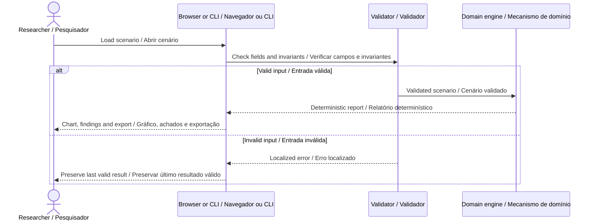

# Architecture · Arquitetura

[README](../README.md) · [Contract / Contrato](DATA_CONTRACT.md)



## English

A deterministic coverage-route simulator for a supplied training-floor grid. It computes reachable cells, plans visits to new cells and reserves enough movement steps to return to the starting point.

1. Compute the connected component of free cells using four-neighbor breadth-first search. Cell values are 0 for free, 1 for obstacle and 2 for excluded.

2. At each iteration, find the nearest unvisited reachable cell. Equal-length paths use east, south, west, north neighbor order; this makes the result reproducible.

3. Before appending an outbound path, compute the shortest return path from its destination. Accept only when outbound movement plus the return fits the remaining budget.

4. When the next greedy candidate cannot be funded, stop searching and append the return path. This policy can leave feasible alternatives unexplored and is not an optimal coverage solver.

5. Count visits during both search and return. Report reachable coverage, unreachable free cells, unvisited reachable cells and remaining steps separately.

```text
distanceM = movementSteps × cellSizeM
coveragePct = 100 × visitedFreeCells / reachableFreeCells
accept next route only if used + outbound + shortestReturn <= maxSteps
```

The engine receives plain JSON and returns plain data. It has no browser, network or private-core dependency. Validation finishes before computation. Reports preserve the source label and analysis version, omit wall-clock timestamps and can be compared byte-for-byte after formatting. The browser uses a revision counter to prevent an older import from replacing a newer result. Every displayed external string is escaped.

## Português

Um simulador determinístico de cobertura para uma grade de piso de treinamento fornecida. Calcula células alcançáveis, planeja visitas a novas células e reserva passos suficientes para retornar ao início.

1. Calcule o componente conectado de células livres por busca em largura com quatro vizinhos. Os valores são 0 para livre, 1 para obstáculo e 2 para excluída.

2. A cada iteração, encontre a célula alcançável não visitada mais próxima. Caminhos de mesmo tamanho usam a ordem leste, sul, oeste, norte; isso torna o resultado reproduzível.

3. Antes de adicionar um caminho de ida, calcule o menor caminho de retorno a partir do destino. Aceite apenas quando ida e retorno couberem no orçamento restante.

4. Quando o próximo candidato da política gulosa não couber no orçamento, encerre a busca e acrescente o retorno. A política pode deixar alternativas viáveis inexploradas e não é um solucionador ótimo de cobertura.

5. Conte visitas tanto na busca quanto no retorno. Informe separadamente cobertura alcançável, células livres inalcançáveis, células alcançáveis não visitadas e passos restantes.

O mecanismo recebe JSON simples e retorna dados simples. Não depende do navegador, rede ou núcleo privado. A validação termina antes do cálculo. Relatórios preservam origem e versão, omitem horários reais de execução e podem ser comparados após formatação. O navegador usa um contador de revisão para impedir que uma importação antiga substitua resultado mais recente. Todo texto externo exibido passa por escape.

## Module boundaries · Limites dos módulos

| Module · Módulo       | Responsibility · Responsabilidade                                                   |
| --------------------- | ----------------------------------------------------------------------------------- |
| `engine.js`           | Validated domain calculation / Cálculo de domínio validado                          |
| `validation.js`       | Strict primitives and report envelope / Validações estritas e envelope do relatório |
| `view.js`             | Domain chart and interpretation / Gráfico e interpretação do domínio                |
| `app.js`              | Import, language, controls and export / Importação, idioma, controles e exportação  |
| `ui.js`               | Escaping, numbers and downloads / Escape, números e downloads                       |
| `scripts/analyze.mjs` | Command-line entry point / Entrada por linha de comando                             |
