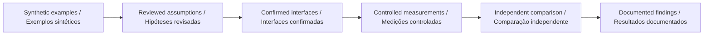

# Go2 PRO development plan · Plano de desenvolvimento com o Go2 PRO

## English

Before a search-and-rescue exercise, instructors need to distinguish a traversed area from a merely drawn route. This workbench exposes disconnected rooms, explicit exclusions and a limited movement budget. It supports course design for a prospective Go2 PRO observation study.

Use a marked, controlled floor plan with explicit excluded areas. First compare simulated cell visits with an independent observer's annotations. Record start/end position, missed cells and unplanned deviations. Treat return-path agreement as a separate outcome; preserve interrupted trials.

## Português

Antes de um exercício de busca e salvamento, instrutores precisam distinguir áreas percorridas de um trajeto apenas desenhado. A bancada evidencia salas desconectadas, exclusões explícitas e orçamento limitado de movimento. Apoia o desenho de percursos para um futuro estudo de observação com o Go2 PRO.

Use uma planta marcada e controlada, com áreas excluídas explícitas. Primeiro compare as visitas simuladas com anotações de um observador independente. Registre posição inicial/final, células não visitadas e desvios imprevistos. Avalie o retorno separadamente e preserve ensaios interrompidos.

| Stage · Etapa                                                     | Current evidence / Evidência atual                                                                     | Completion condition / Condição de conclusão                                                                 |
| ----------------------------------------------------------------- | ------------------------------------------------------------------------------------------------------ | ------------------------------------------------------------------------------------------------------------ |
| Software model / Modelo de software                               | Implemented, with tests and reproducible scenarios / Implementado, com testes e cenários reproduzíveis | Review the domain assumptions / Revisar hipóteses do domínio                                                 |
| Platform configuration / Configuração da plataforma               | Pending exact interface confirmation / Pendente de confirmação exata das interfaces                    | Written configuration and interface compatibility / Compatibilidade documentada de configuração e interfaces |
| Adapter / Adaptador                                               | No vendor/device adapter in this release / Sem adaptador de fabricante/dispositivo nesta versão        | Separate implementation and interface tests / Implementação e testes de interface próprios                   |
| Physical measurements / Medições físicas                          | Not performed by this repository / Não realizadas por este repositório                                 | Controlled protocol and independent measurements / Protocolo controlado e medições independentes             |
| Participant or field study / Estudo com participantes ou em campo | Not established / Não estabelecido                                                                     | Separate study design and applicable review / Desenho de estudo e revisão aplicável próprios                 |

## Configuration evidence · Evidência de configuração

The [official Go2 page](https://www.unitree.com/go2/) distinguishes configurations; its comparison lists secondary development for EDU and marks it unavailable for the standard PRO. The existence of [Unitree SDK2](https://github.com/unitreerobotics/unitree_sdk2) does not establish access for a particular PRO unit. Confirm supported interfaces and commercial configuration directly before device work. Reviewed on 2026-09-10.

A [página oficial do Go2](https://www.unitree.com/go2/) distingue configurações; sua comparação lista desenvolvimento secundário para EDU e o marca indisponível no PRO padrão. A existência do [Unitree SDK2](https://github.com/unitreerobotics/unitree_sdk2) não comprova acesso em uma unidade PRO específica. Confirme interfaces e configuração comercial diretamente antes do trabalho com o dispositivo. Revisado em 10/09/2026.

The prototype's scientific usefulness does not depend on claiming unsupported interfaces: it can structure hypotheses and analyze separately collected observations. / A utilidade científica do protótipo não depende de afirmar interfaces sem suporte: ele estrutura hipóteses e analisa observações coletadas separadamente.
