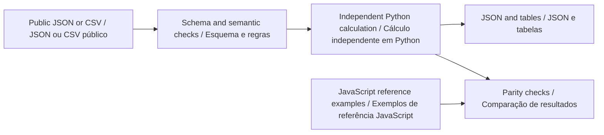

# Python offline guide · Guia Python offline

[English](#english) · [Português](#portugues) · [Project / Projeto](../README.md)

**Python companion v0.2.0 · Python 3.11+ · Python · JavaScript**



<a id="english"></a>

## English

Plan the same deterministic four-neighbor search route in Python, then replan it under several movement budgets. The batch table makes it possible to compare proposed classroom floor plans without repeatedly editing a browser form.

### Install and run

From the repository root, create a virtual environment with `python -m venv .venv`. Activate it with `.venv\Scripts\Activate.ps1` in PowerShell or `source .venv/bin/activate` in a Unix shell. Use `python3` instead of `python` if required by your installation.

```sh
python -m pip install -r requirements-python.txt .
python -m go2_coverage --help
python -m go2_coverage analyze examples/nominal.json review-output/nominal.report.json
python -m go2_coverage sweep examples/nominal.json review-output/sensitivity.csv
```

The first analysis creates `review-output/`. Use a new SQLite filename for a new archive, when applicable. Reimporting the same scenario identifier is rejected to preserve the previous record. Runtime calculations require Python and the declared schema-validation dependencies; Node is needed only for the browser application and cross-language tests.

### Method and worked example

Breadth-first search identifies the reachable component. Neighbors are explored east, south, west, north. Before accepting the nearest unvisited destination, the planner reserves its shortest return path. It stops when that next greedy choice cannot fit. Coverage includes cells visited during return. This policy is deterministic, but is not an optimal coverage solver.

```text
distanceM = steps * cellSizeM
coveragePct = 100 * visitedCells / reachableCells
```

The nominal 24-cell floor returns to its start after 24 steps: 12 m at 0.5 m/cell and 100% reachable coverage. A zero-step budget visits only the starting cell (4.166667%). The CSV preserves each tested budget, actual steps, visited cells, coverage, distance and return status.

Browse the [committed inputs and outputs](../examples/python/README.md). CSV column order and names must match the example header exactly. Missing columns, extra columns, malformed numbers, duplicate identifiers and non-finite values are rejected where applicable. JSON rejects unknown fields and duplicate object keys. The public [scenario schema](../schemas/scenario.schema.json) defines units and field bounds; the domain module adds relationships that JSON Schema alone cannot express.

### Use as a library

```python
from pathlib import Path
from go2_coverage import analyze
from go2_coverage.contract import read_json

scenario = read_json(Path("examples/nominal.json"))
result = analyze(scenario)
print(result["scenarioId"])
```

See the [calculation module](../python/go2_coverage/core.py) and [CLI](../python/go2_coverage/__main__.py). The Python result is a documented offline summary, not the complete bilingual browser report envelope. Shared numerical fields and paths are independently compared; matching output is a software consistency check, not physical validation.

### Verify

Install Node.js 22+ for the independent JavaScript comparisons, then run:

```sh
python -m unittest discover -s python/tests -v
python scripts/check-python-examples.py
npm test
```

The Python suite covers the strict public contract, unchanged inputs, invalid-file handling, preservation of previous outputs, domain boundaries and every canonical example listed in `examples/index.json`. The example checker executes the documented workflows in a temporary directory and compares JSON/CSV artifacts. Use its `--write` option only after intentionally reviewing a changed result. CLI exit status is 0 for a completed calculation and 1 for invalid input or a failed integrity check. Inspect result flags for review conditions; this differs from the browser CLI's status-2 convention.

### Interpretation boundary

A visited point-cell is not evidence of detecting a person. Clearance, visibility, heat, terrain, battery and physical motion remain outside this model. Budget sweeps do not prove the best achievable coverage.

Go2 PRO remains the proposed observation platform. These tools contain no robot commands, and custom SDK support on standard PRO hardware is not assumed. See the [hardware study plan](GO2_PRO_PLAN.md).

<a id="portugues"></a>

## Português

Planeje a mesma rota determinística de busca com quatro vizinhos em Python e repita o planejamento com diferentes orçamentos de movimento. A tabela permite comparar pisos propostos para treinamento sem editar repetidamente o formulário do navegador.

### Instalação e execução

Na raiz do repositório, crie o ambiente com `python -m venv .venv`. Ative com `.venv\Scripts\Activate.ps1` no PowerShell ou `source .venv/bin/activate` em um shell Unix. Use `python3` se essa for a nomenclatura da instalação. Execute a sequência de comandos da seção inglesa: ela é a mesma nos dois idiomas. A primeira análise cria `review-output/`.

Instale com `python -m pip install -r requirements-python.txt .`. Os cálculos dependem de Python e das dependências declaradas para validação de esquema. Node.js 22+ é necessário somente para o aplicativo de navegador e para os testes entre linguagens. Quando houver SQLite, use um arquivo novo para um novo arquivo de análise; identificadores de cenário repetidos são rejeitados, preservando os registros existentes.

### Método e exemplo explicado

A busca em largura identifica o componente alcançável. Vizinhos são explorados a leste, sul, oeste e norte. Antes de aceitar o destino não visitado mais próximo, o planejador reserva seu caminho mínimo de retorno. Para quando a próxima escolha gulosa não cabe. A cobertura inclui células visitadas no retorno. A política é determinística, mas não é um otimizador de cobertura.

O piso nominal de 24 células retorna ao início após 24 passos: 12 m com 0,5 m/célula e 100% de cobertura alcançável. Um orçamento zero visita apenas a célula inicial (4,166667%). O CSV preserva orçamento testado, passos usados, células visitadas, cobertura, distância e retorno.

As fórmulas e os comandos acima usam nomes de campos estáveis, compartilhados pelos dois idiomas. Consulte as [entradas e saídas versionadas](../examples/python/README.md). Cabeçalhos CSV devem corresponder exatamente ao exemplo, incluindo a ordem. Colunas ausentes ou extras, números malformados, identificadores duplicados e valores não finitos são rejeitados quando aplicável. JSON rejeita campos desconhecidos e chaves repetidas. O [esquema público](../schemas/scenario.schema.json) define unidades e limites; o módulo de domínio valida relações adicionais.

### Biblioteca e validação

O exemplo Python da seção inglesa funciona diretamente. O [módulo de cálculo](../python/go2_coverage/core.py) retorna um resumo offline documentado; ele não replica todo o envelope bilíngue do relatório de navegador. Os campos numéricos e caminhos compartilhados são comparados independentemente. Concordância é uma verificação de consistência do software, não validação física.

Execute `python -m unittest discover -s python/tests -v`, `python scripts/check-python-examples.py` e `npm test`. A suíte Python cobre o contrato, preservação de entradas, arquivos inválidos, manutenção da saída anterior, limites do domínio e todos os exemplos canônicos do índice. O verificador executa os fluxos em diretório temporário e compara os artefatos JSON/CSV. Use `--write` somente após revisar uma mudança intencional. O código de saída é 0 para cálculo concluído e 1 para entrada inválida ou falha de integridade. Consulte as sinalizações do resultado; a convenção difere do código 2 da interface de análise em JavaScript.

### Limites de interpretação

Uma célula pontual visitada não comprova detecção de uma pessoa. Folga corporal, visibilidade, calor, terreno, bateria e movimento físico ficam fora do modelo. A varredura de orçamentos não comprova a melhor cobertura possível.

O Go2 PRO continua como plataforma proposta de observação. Estas ferramentas não contêm comandos de robô nem pressupõem suporte a SDK personalizado no PRO padrão. Consulte o [plano de estudo com hardware](GO2_PRO_PLAN.md).
